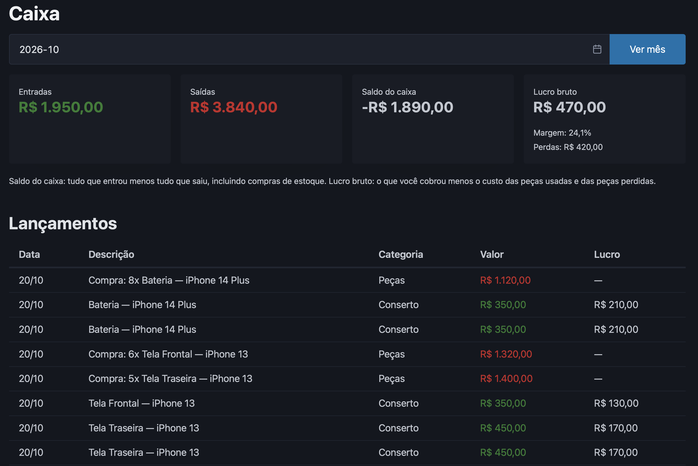
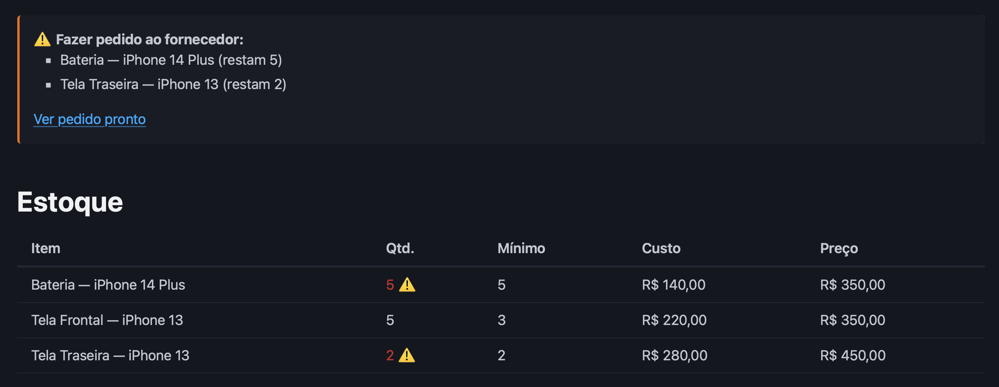
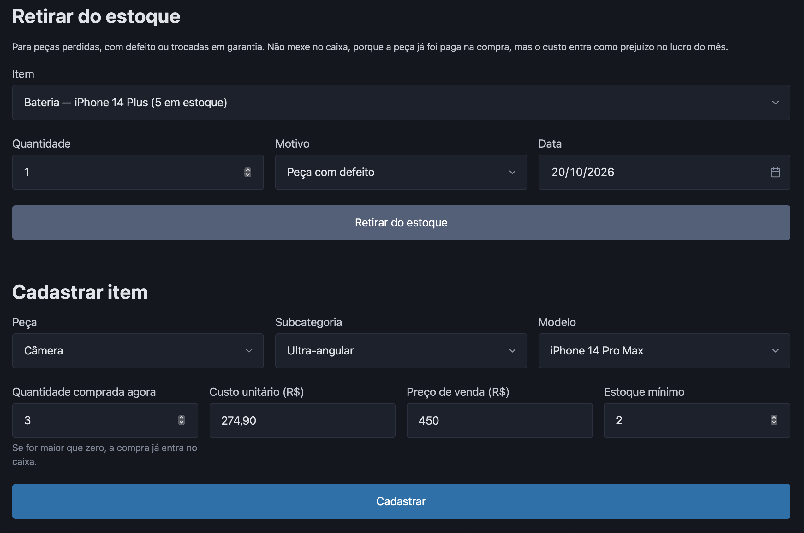

# Caixa Assistência


Sistema de caixa e estoque para uma pequena assistência técnica de iPhones: consertos (tela, bateria, câmera, microfone, conector de carga), venda de acessórios (películas e capinhas) e controle de peças.



> 🚧 Em desenvolvimento. O nome e o visual são provisórios: a marca e a identidade visual ainda estão sendo criadas.

## Funcionalidades

**Caixa**
- Resumo do mês: entradas, saídas, saldo do caixa, lucro bruto e margem
- Lucro de cada lançamento e ranking de lucro por serviço
- Lançamentos avulsos (despesas e serviços fora do estoque), com custo opcional

**Estoque**
- Catálogo estruturado por peça → subcategoria → modelo (ex.: Tela → Frontal → iPhone 11), sem texto livre
- Registro de conserto ou venda pelo catálogo: o preço é sugerido e a peça sai do estoque automaticamente
- Compras do fornecedor somam no estoque e entram no caixa como saída
- Alerta de estoque mínimo em todas as páginas e pedido ao fornecedor pronto para enviar pelo WhatsApp
- Retirada por perda (troca em garantia, defeito, quebra): não mexe no caixa, mas entra como prejuízo no lucro

## Stack

| Camada | Tecnologia |
|---|---|
| Back-end | Python 3.12+ e Flask |
| Front-end | HTML com Jinja, Pico CSS e JavaScript |
| Banco de dados | SQLite |
| Testes | pytest |
| Integração contínua | GitHub Actions |

## Arquitetura

O domínio fica no centro do projeto: ele não depende de nenhuma outra camada, e são as rotas e os repositórios que dependem dele.

```
Navegador
   │  páginas (GET) e formulários (POST)
   ▼
Rotas ............ app.py
   │  recebe os dados, aciona os repositórios e renderiza os templates
   ▼
Dados ............ repositorio.py, repositorio_estoque.py, banco.py
   │  SQL, transações e migrações
   ▼
SQLite (caixa.db)

Domínio .......... modelos.py, estoque.py, calculos.py, dinheiro.py, catalogo.py
   regras de negócio e validações, usadas pelas rotas e pelos repositórios
   (não importa nenhuma outra camada: sem SQL, sem HTML, sem Flask)
```

Como as regras de negócio não dependem do banco nem da web, elas são testadas isoladamente, em milissegundos. Trocar o SQLite por outro banco, por exemplo, afetaria só a camada de dados.

## Decisões de projeto

- **Dinheiro em centavos inteiros.** Valores são `int` (R$ 49,90 → `4990`), nunca `float`: em ponto flutuante, `0.1 + 0.2` resulta em `0.30000000000000004`.
- **Caixa não é lucro.** Uma compra de peças é saída de caixa quando é paga, mas só vira custo quando a peça é usada num conserto ou perdida (regime de caixa × regime de competência). Por isso o saldo pode ficar negativo num mês de reposição de estoque, mesmo com lucro positivo.
- **Custo histórico.** Cada conserto e cada perda guardam o custo da peça no dia em que aconteceram. Se o fornecedor aumentar o preço, o lucro dos meses anteriores não muda.
- **Uma única porta de entrada no estoque.** Toda peça entra por uma compra registrada no caixa; não existe estoque que "aparece" sem o dinheiro correspondente ter saído.
- **Transações.** Operações que mexem no estoque e no caixa ao mesmo tempo são atômicas: ou tudo acontece, ou nada acontece.
- **Validação em camadas.** O JavaScript ajuda o usuário (ex.: só mostra subcategorias válidas), o servidor valida todos os dados nos modelos, e o banco tem restrições próprias (`UNIQUE`, `CHECK`).
- **Padrão Repositório e migrações.** O acesso ao banco fica isolado em repositórios, e bancos de versões antigas são atualizados automaticamente sem perder dados.
- **Segurança.** Placeholders no SQL contra *SQL injection* e escape automático dos templates contra *XSS*, ambos cobertos por testes.

## Modelo de dados

```
estoque             lancamentos               perdas
───────             ───────────               ──────
id                  id                        id
peca                data                      data
variante            descricao                 item_id (FK → estoque)
modelo              categoria                 descricao
quantidade          valor_centavos            quantidade
custo_centavos      tipo                      custo_unitario_centavos
preco_centavos      item_id (FK → estoque)    motivo
minimo              custo_centavos
```

- `estoque`: cada combinação de peça + subcategoria + modelo é única (`UNIQUE`), e a quantidade nunca fica negativa (`CHECK`).
- `lancamentos.item_id`: liga um conserto ou uma compra ao item de estoque; fica vazio em lançamentos avulsos.
- `lancamentos.custo_centavos` e `perdas.custo_unitario_centavos`: guardam o custo histórico da peça.

## Estrutura

```
caixa-assistencia/
├── caixa/
│   ├── dinheiro.py              # conversão e formatação de valores
│   ├── modelos.py               # lançamentos e perdas
│   ├── catalogo.py              # peças, subcategorias e modelos
│   ├── estoque.py               # itens de estoque, alerta e pedido
│   ├── calculos.py              # saldo, lucro, margem e rankings
│   ├── banco.py                 # conexão, transações e migrações
│   ├── repositorio.py           # acesso aos lançamentos
│   └── repositorio_estoque.py   # estoque integrado ao caixa
├── templates/
│   ├── base.html                # layout comum: menu, alertas e mensagens
│   ├── index.html               # caixa: resumo do mês, lançamentos e consertos
│   └── estoque.html             # estoque: itens, compras, perdas e cadastro
├── static/
│   └── catalogo.js              # filtro de subcategorias, usado nas duas páginas
├── tests/                       # testes automatizados (pytest)
├── docs/telas/                  # capturas de tela
├── app.py                       # rotas da aplicação web (Flask)
└── .github/workflows/testes.yml # CI com GitHub Actions
```

## Como rodar

Requer Python 3.12 ou superior.

```bash
git clone https://github.com/davidfwallace/caixa-assistencia.git
cd caixa-assistencia
python3 -m venv .venv
source .venv/bin/activate
pip install -r requirements.txt
python app.py
```

Acesse http://127.0.0.1:5001

Testes:

```bash
pytest -v
```

## Testes e integração contínua

São 100 testes automatizados: testes de unidade (cálculos, validações, casos de borda), testes do banco (transações, migração de bancos antigos, proteção contra SQL injection) e testes de integração que percorrem o fluxo completo, como "um conserto baixa o estoque até o mínimo e dispara o alerta". A cada push, o GitHub Actions roda toda a suíte em Python 3.12, 3.13 e 3.14.

## Próximos passos

- [x] Interface web com Flask
- [x] Persistência em SQLite
- [x] Estoque com alerta de mínimo e pedido ao fornecedor
- [x] Lucro por serviço e registro de perdas
- [ ] Ordens de serviço com status, aviso ao cliente por WhatsApp e controle de garantia
- [ ] Estorno de lançamentos (desfazer uma compra ou conserto registrado por engano)
- [ ] Marca e identidade visual
- [ ] Importação de lançamentos a partir de CSV
- [ ] Lucro por aparelho seminovo (compra com defeito → peças → revenda)
- [ ] Expansão para outros aparelhos (ex.: Apple Watch, MacBook, iPad)

## Telas

**Estoque com alerta de baixa quantidade**



**Retirada por perda e cadastro de item pelo catálogo**



## Autor

João Gustavo G. Pires — Eng. da Computação, CIn - UFPE


